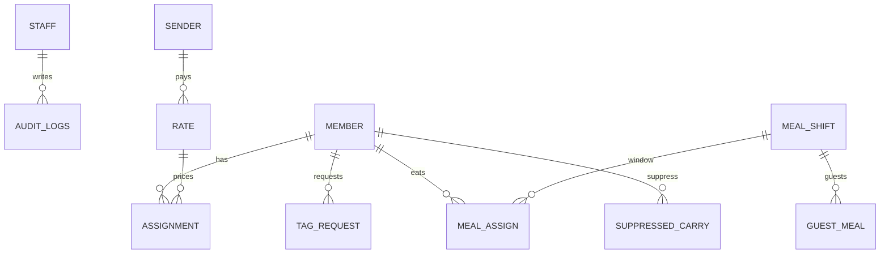

# Database

PostgreSQL 16. Production schema is created only by `alembic upgrade head`. `0001` applies `backend/schema.sql`. `0002` adds refresh/MFA/RBAC/files/notifications. `Base.metadata.create_all()` is off unless `ALLOW_CREATE_ALL=true` (isolated tests).

## Major tables

| Table | Kind | Purpose |
| ----- | ---- | ------- |
| `staff` | master | Desk logins (cc, daily, mess, consume, ration, admin) |
| `members` | master | Mess members (RAB ID unique when non-empty) |
| `assignments` | transaction | One tag per member per date |
| `tag_requests` | workflow | Pending/updated/rejected tag changes by queue |
| `suppressed_carries` | transaction | Stop default-tag carry on a day |
| `day_locks` | transaction | Approved days |
| `boro_khana_days` | transaction | Special mess days |
| `rates` | master | Allowance per tag |
| `senders` | master | Bank accounts mapped to payout tags |
| `catalog_state` | lookup blob | ranks/wings/forces/banks JSON |
| `authorized_strength` | master | Form 1 authorized counts |
| `manpower_officer_absent` | transaction | Daily wing absents |
| `state_reports` | workflow | Daily → admin duty reports |
| `meal_shifts` | master | Breakfast/lunch/dinner windows |
| `meal_plans` | transaction | Planned meals by date |
| `meal_assigns` | transaction | Member check-ins |
| `guest_meals` | transaction | Guest check-ins |
| `pritibhoj_events` | transaction | Feast sheets |
| `audit_logs` | audit | Who/what/when (added for production) |
| `refresh_sessions` | auth | Hashed refresh tokens + rotation family |
| `password_resets` | auth | Hashed one-time reset tokens |
| `permissions` / `role_permissions` | authz | Desk permission map |
| `file_objects` | storage | Upload metadata (bytes in local/S3) |
| `notifications` | notify | Persistent per-staff inbox |

## Important constraints

- `members`: unique `lower(rab_id)` when `rab_id <> ''`
- `assignments`: unique `(user_id, date)`
- `tag_requests`: unique pending `(user_id, queue)` where `status = 'requested'`

## Status fields

- Member `status`: `"1"` active, `"0"` inactive
- Member `approval_status`: `pending` → `approved` | `rejected`
- Tag request `status`: `requested` → `updated` | `rejected`
- State report `status`: `pending` → approved/rejected (frontend)

## ER (core)



Catalog JSON should eventually become normalized lookup tables. It remains a blob because Settings already edits it as one document.

## Migrations

```bash
cd backend
alembic upgrade head
```

Empty database → `alembic upgrade head` → seed staff/rates/senders/meal shifts only. Never seed demo members in production migrations.
